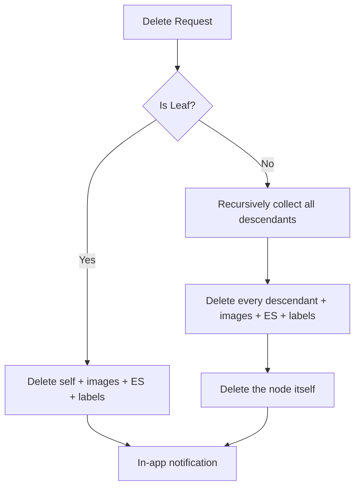
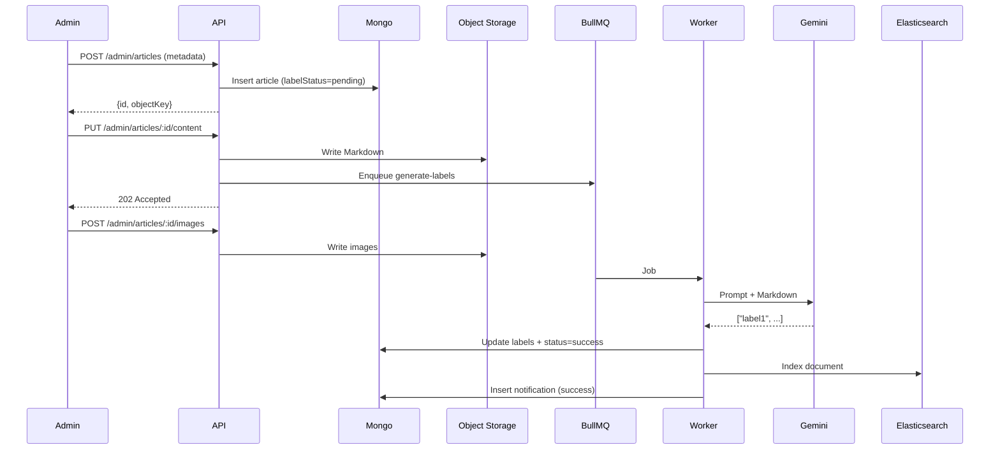
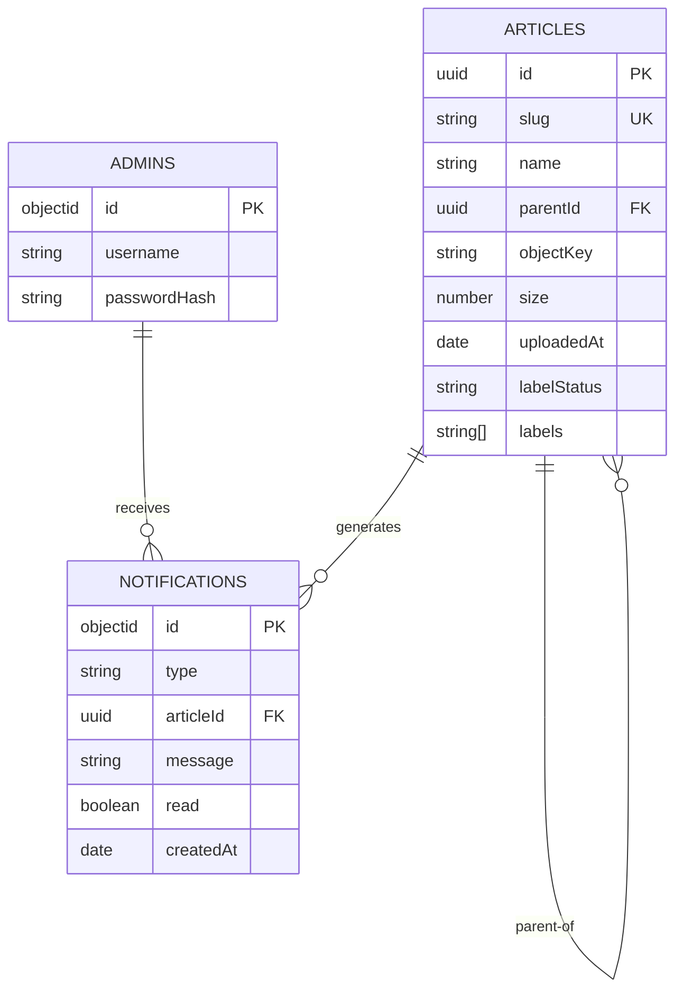
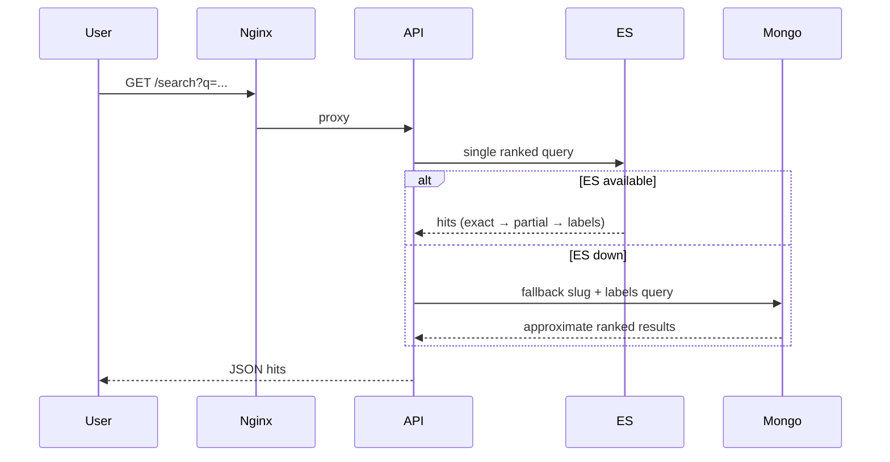

**MASTER SYSTEM SPECIFICATION**  
**Project:** Nursing & Medicine Wiki  
**Version:** 1.0.0  
**Status:** Production-ready for downstream execution agents  
**Date:** 2026-11-07

---

### 1. Executive Summary & Core Invariants

**Purpose**  
A specialized, hierarchical knowledge base for nursing and medical content. Content lives as Markdown files + images in local object storage. Metadata, hierarchy, and search labels live in MongoDB + Elasticsearch. Single-owner write model. Public read + search. Designed as an over-engineered showcase of system design competence.

**Target Users**
- Public: anonymous readers and searchers.
- Owner (single admin): authenticated uploader, hierarchy manager, and notification consumer.

**Unbreakable Business Logic Invariants**
1. Only the single owner may create, upload, or delete content. All other endpoints that mutate state must reject non-owner requests with 401/403.
2. Articles are immutable after upload. No edit path exists. Only create + delete.
3. Hierarchy is parent-UUID adjacency list. Empty folders never persist. A folder materializes only when at least one file is successfully uploaded under it.
4. Delete cascade:
   - Leaf article → delete self + its images + its labels + its Elasticsearch document.
   - Non-leaf → recursive delete of all descendants + their images + labels + Elasticsearch documents.
5. Search ranking order is mandatory and non-negotiable:
   1. Exact slug match
   2. Partial slug match
   3. Label match
   Full Markdown body is never indexed or searched.
6. Label generation is asynchronous, non-blocking, and must never block the upload response.
7. Public read and search endpoints must remain available even if authentication, BullMQ, or Gemini are unavailable (graceful degradation).
8. All image references inside Markdown are relative paths. Missing images render as the literal string `[no image]`.
9. Maximum sizes: Markdown ≤ 6 MB, each image ≤ 20 MB.
10. Source of truth for file existence is the local object storage. MongoDB and Elasticsearch are derived indexes.

---

### 2. Execution Agent Guardrails (Strict Enforcement)

Downstream agents (Codex, OpenCode, Cursor, etc.) must obey these rules without exception:

- **Database Safety**: Never execute `DROP`, `TRUNCATE`, `DELETE` without a `WHERE` clause that limits scope, or any migration that can destroy data, without explicit human confirmation in the PR description.
- **Git Safety**: Never force-push, rebase public/main branches, or commit directly to protected branches. All changes via feature branches + PR.
- **Filesystem Safety**: Never run `rm -rf /`, recursive deletes outside the designated object-storage volume, or install unvetted global packages. All package installs must be pinned and appear in `package.json` / lockfile.
- **Testing**: Every new business-logic path (upload, delete cascade, label job, search ranking, auth) must ship with unit + integration tests. No PR is mergeable without test coverage for the changed surface.
- **Secrets**: All secrets (JWT secret, Gemini API key, Mongo credentials) must come from environment variables. Never hard-code.
- **Idempotency**: Upload and delete operations must be idempotent where technically feasible (content-hash checks, existence guards).

---

### 3. UI/UX Aesthetics & Constraints (“No AI Slop” Mandate)

**Philosophy**  
Calm, precise, trustworthy, professional medical-education grade. Attractiveness comes from typography, spacing, rhythm, and high legibility — never from decoration.

**Strictly Forbidden**
- Purple, violet, or indigo gradients (backgrounds, buttons, text).
- Any colorful gradient backgrounds or gradient text.
- Glassmorphism / frosted glass.
- Heavy drop shadows or floating “card in the air” aesthetics.
- Excessive border-radius (no pill-shaped everything).
- Unnecessary animations, micro-interactions, or hover effects beyond simple opacity/color transitions.
- Bouncy, elastic, or playful transitions.
- Abstract blob shapes, floating 3D elements, decorative illustrations.
- Trendy SaaS startup visual language or soft pastel schemes.
- Neon/oversaturated accents.
- Cluttered bento-box layouts.

**Required**
- Neutral / monochrome base (near-white background, near-black text, restrained grays).
- Single semantic accent color: deep clinical blue (`#0B3C5D` or equivalent muted teal).
- High contrast, generous line-height, clear hierarchy.
- Content-first layouts. Long-form reading comfort is primary.
- Purposeful interaction only.
- Two distinct React applications:
  - **Public app**: article reader + search.
  - **Admin app**: file-explorer upload UI, hierarchy tree, notification dashboard, credential change.

---

### 4. Repository & Folder Structure

```
nursing-medicine-wiki/
├── apps/
│   ├── api/                          # Fastify + TypeScript backend
│   │   ├── src/
│   │   │   ├── routes/
│   │   │   ├── services/
│   │   │   ├── workers/              # BullMQ processors
│   │   │   ├── models/               # MongoDB schemas
│   │   │   ├── lib/
│   │   │   ├── config/
│   │   │   └── index.ts
│   │   ├── tests/
│   │   ├── Dockerfile
│   │   └── package.json
│   ├── public-web/                   # Public React SPA
│   │   ├── src/
│   │   ├── Dockerfile
│   │   └── package.json
│   └── admin-web/                    # Admin React SPA
│       ├── src/
│       ├── Dockerfile
│       └── package.json
├── packages/
│   └── shared/                       # Shared types, constants, Zod schemas
├── infra/
│   ├── nginx/
│   │   └── nginx.conf
│   └── docker-compose.yml
├── scripts/
│   ├── seed-admin.ts
│   └── healthcheck.sh
├── docs/
│   └── architecture.md               # This specification lives here
├── .env.example
├── .gitignore
└── README.md
```

Object storage volume (host-mounted): `/data/objects`  
Inside containers the same path is used.

---

### 5. Detailed Product & Functional Specifications

#### 5.1 Module: Authentication
- Single owner identity stored in MongoDB `admins` collection (username + bcrypt hash).
- Default credentials created on first boot via seed script; changeable via admin UI.
- JWT (HS256), expiry 7 days, issued on successful login.
- Refresh: re-login only (no refresh-token rotation for this scope).
- Middleware: all routes except `GET /articles/:slug`, `GET /search`, `GET /health*` require valid JWT + owner claim.

#### 5.2 Module: Hierarchy & Metadata
- Article document fields: `_id` (UUID), `slug`, `name`, `parentId` (UUID | null), `objectKey`, `size`, `uploadedAt`, `labelStatus` (`pending` | `success` | `failed`), `labels` (string[]).
- Folder existence is implicit: a folder path exists if any article has that parent chain.
- Admin explorer UI must present a tree derived from adjacency list and allow navigation + upload into any existing or new path.

#### 5.3 Module: Upload Pipeline (Admin only)
Sequential, separate endpoints:
1. `POST /admin/articles` → create metadata (returns UUID + suggested object keys).
2. `PUT /admin/articles/:uuid/content` → upload Markdown (≤ 6 MB). Validates relative image paths exist or will exist.
3. `POST /admin/articles/:uuid/images` → multipart image upload (≤ 20 MB each). Stores under deterministic keys derived from article UUID + original filename.
4. On successful Markdown upload → enqueue BullMQ job `generate-labels`.

#### 5.4 Module: Delete
- `DELETE /admin/articles/:uuid`
- Resolves full descendant set via recursive adjacency walk.
- Deletes: object-storage files (MD + images), MongoDB documents, Elasticsearch documents.
- Emits in-app notification on completion.

#### 5.5 Module: Label Generation (Async)
- BullMQ queue `label-generation`.
- Job payload: `{ articleId: UUID, markdownText: string }`.
- Worker calls Gemini API with fixed prompt that forces output of 6–7 short medical/nursing label strings.
- On success: update MongoDB `labels` + `labelStatus`, index into Elasticsearch, in-app success notification.
- Failure path: BullMQ retry → after 2 daily attempts move to DLQ → in-app error notification.

#### 5.6 Module: Search
- `GET /search?q=...`
- Single Elasticsearch query implementing the mandatory ranking:
  1. Exact `slug.keyword` match (highest boost)
  2. Partial `slug` match
  3. `labels` match
- Fallback when Elasticsearch is unavailable: MongoDB text/regex search on `slug` + `labels` only, same precedence order approximated in application code.

#### 5.7 Module: Public Article Read
- `GET /articles/:slug` → returns Markdown content (from object storage) + metadata + resolved breadcrumb path.
- Images served directly from local object storage via Nginx static location.

#### 5.8 Module: Notifications
- In-app only, stored in MongoDB `notifications` collection.
- Visible exclusively in admin dashboard.
- Types: `label-success`, `label-failed`, `storage-full`, `delete-complete`.

#### 5.9 Module: Health
- `GET /health/live` → process alive
- `GET /health/ready` → Mongo + Redis + object-storage volume writable + Elasticsearch (degraded OK)

---

### 6. Architecture & Infrastructure Blueprint

**Runtime Topology (Docker Compose)**
- `api` (Fastify + TypeScript + BullMQ workers in same process or separate worker container)
- `mongo`
- `elasticsearch`
- `redis` (BullMQ only)
- `nginx` (TLS termination, static image serving, reverse proxy to api + two SPAs)
- `public-web` / `admin-web` (static build served by Nginx)

**Object Storage**
- Host path `/data/objects` mounted read-write into api + nginx.
- Key scheme: `articles/{uuid}/{filename}` for Markdown and images.
- Public read via Nginx `location /objects/`.

**Caching**
- None. Explicitly disabled per requirements.

**Async**
- BullMQ + Redis.
- Queue: `label-generation`
- DLQ: `label-generation-dlq` with daily retry limit of 2.

**API Gateway / LB**
- Nginx only. No separate API gateway.
- Rate limiting: none.

**Observability**
- Structured JSON logs.
- Health endpoints as defined.
- No external APM required for this scope.

---

### 7. Database Schemas & Data Contracts

#### MongoDB Collections

**admins**
```json
{
  "_id": "ObjectId",
  "username": "string",
  "passwordHash": "string",
  "updatedAt": "Date"
}
```

**articles**
```json
{
  "_id": "UUID",
  "slug": "string (unique, URL-safe)",
  "name": "string",
  "parentId": "UUID | null",
  "objectKey": "string",
  "size": "number",
  "uploadedAt": "Date",
  "labelStatus": "pending | success | failed",
  "labels": ["string"],
  "createdAt": "Date",
  "updatedAt": "Date"
}
```
Indexes: `{ slug: 1 }` unique, `{ parentId: 1 }`, `{ labelStatus: 1 }`

**notifications**
```json
{
  "_id": "ObjectId",
  "type": "label-success | label-failed | storage-full | delete-complete",
  "articleId": "UUID | null",
  "message": "string",
  "read": "boolean",
  "createdAt": "Date"
}
```

#### Elasticsearch Index `articles`
```json
{
  "mappings": {
    "properties": {
      "id":          { "type": "keyword" },
      "slug":        { "type": "text", "fields": { "keyword": { "type": "keyword" } } },
      "name":        { "type": "text" },
      "labels":      { "type": "keyword" },
      "parentId":    { "type": "keyword" },
      "uploadedAt":  { "type": "date" }
    }
  }
}
```

#### API Contracts (selected)
- `POST /admin/login` → `{ token: string }`
- `POST /admin/articles` → `{ id: UUID, slug: string, objectKey: string }`
- `PUT /admin/articles/:id/content` (raw Markdown body)
- `POST /admin/articles/:id/images` (multipart)
- `DELETE /admin/articles/:id`
- `GET /articles/:slug` → full article DTO + breadcrumb
- `GET /search?q=` → ranked hit list
- `GET /admin/notifications`
- `PATCH /admin/notifications/:id/read`

#### Gemini Prompt Contract (fixed)
```
You are a medical and nursing taxonomy expert. 
Read the following Markdown article and output ONLY a JSON array of 6 to 7 short, precise labels (strings) that best describe the clinical content. 
No explanations, no markdown, no extra text.
Article:
{{markdown}}
```

---

### 8. Comprehensive Mermaid Diagrams

**Hierarchy & Delete Cascade (Flowchart)**


**Upload + Label Pipeline (Sequence)**


**Entity Relationship (ERD)**


**Public Search Flow**


---

**End of Master System Specification**

Downstream agents must treat every section above as normative. Any deviation requires an explicit architecture amendment.
